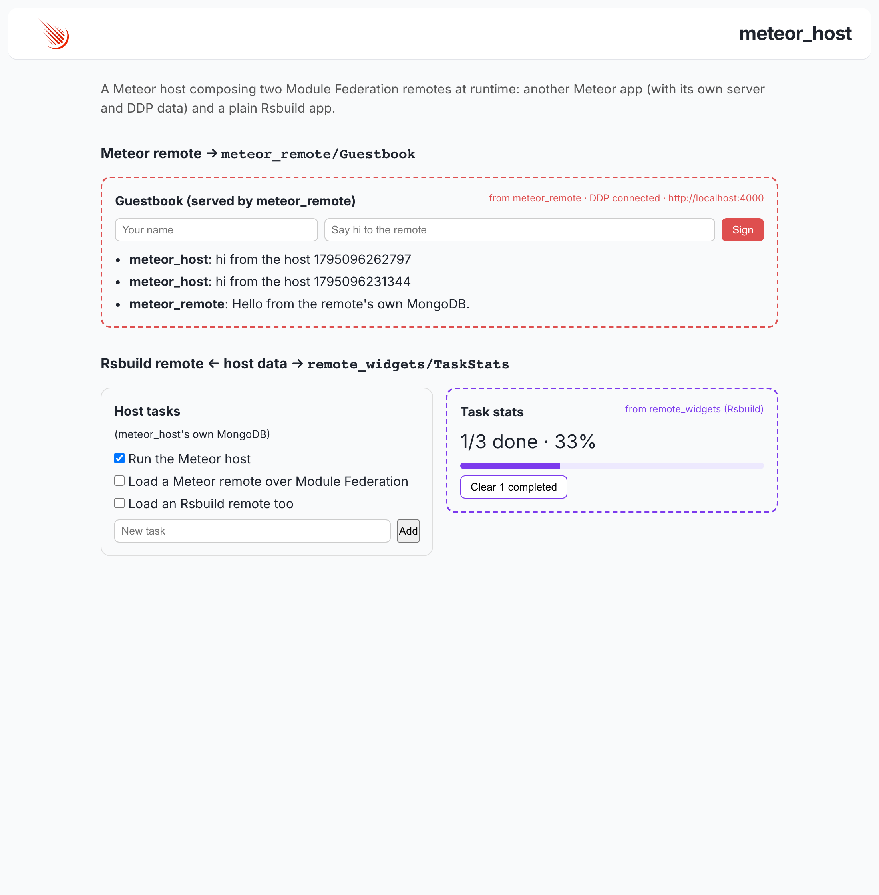

# Meteor + Module Federation

A Meteor 3.6 app (Rspack bundler, TypeScript) acting as a Module Federation **host**, loading two **remotes** at runtime:

| App | Port | Role | Exposes / consumes |
|---|---|---|---|
| `apps/meteor-host` | 3000 | Meteor host | `import("meteor_remote/Guestbook")`, `import("remote_widgets/TaskStats")` |
| `apps/meteor-remote` | 4000 | Meteor remote | exposes `./Guestbook`: a reactive Meteor component backed by **its own** server and MongoDB |
| `apps/remote-widgets` | 3030 | Rsbuild remote | exposes `./TaskStats`, rendered with the host's Meteor data passed as props |

Both Meteor apps use the same Rspack plugin, [`packages/meteor-rspack-federation`](packages/meteor-rspack-federation), from their `rspack.config.ts`.



## Run it

```bash
npm install                                   # Playwright, TypeScript, the plugin's types
(cd apps/meteor-host && meteor npm install)
(cd apps/meteor-remote && meteor npm install)
npm --prefix apps/remote-widgets install

npm run dev:remote          # Rsbuild remote on :3030
npm run dev:meteor-remote   # Meteor remote on :4000 (Mongo on :4001)
npm run dev:host            # Meteor host on :3000, settings.dev.json
open http://localhost:3000

npm run typecheck           # plugin, both Meteor apps, Rsbuild remote, e2e
npm run test:e2e            # boots whatever isn't running, then 5 browser tests
```

Production mode: `npm run prod:remote`, then `meteor run --production --port 4000` in `apps/meteor-remote` and `meteor run --production --port 3000 --settings settings.json` in `apps/meteor-host`. The same e2e suite passes against it.

## The plugin

```ts
// apps/meteor-host/rspack.config.ts
export default defineConfig((Meteor) => ({
  plugins: [
    ...meteorFederation(Meteor, {
      name: "meteor_host",
      remotes: { meteor_remote: "http://localhost:4000/__rspack__/mf-manifest.json", ... },
    }),
  ],
}));

// apps/meteor-remote/rspack.config.ts
...meteorFederation(Meteor, {
  name: "meteor_remote",
  origin: "http://localhost:4000",
  exposes: { "./Guestbook": "./imports/federated/guestbook/Guestbook.tsx" },
}),
```

### Why plain `ModuleFederationPlugin` isn't enough

Meteor documents Module Federation as unsupported in its Rspack integration. If you add `ModuleFederationPlugin` to `rspack.config.ts` directly, the build succeeds but the output can't work:

1. **The container is `commonjs2`.** Meteor sets `output.library: commonjs2` because Meteor's module system loads the Rspack bundle. Browsers can't load a commonjs2 `remoteEntry.js`.
2. **Nothing gets shared.** Meteor marks `react`, `react-dom` and `meteor/*` as externals so Meteor itself supplies them. Externals win over MF's ConsumeShared, so the manifest lists `shared: []` and the exposed chunk contains `require("react")`, which crashes on any other page.

### What `meteorFederation()` does

- **Browser container.** The container is emitted as a `var` library. Its public path, set via `getPublicPath`, is the remote's origin: `/__rspack__/` under `meteor run`, `/` in builds. Meteor's own entry keeps `/`.
- **Scoped externals.** Modules under `imports/federated/` resolve `react*` and `meteor/*` through the MF share scope, with `import: false` so the host must provide them. All other app code keeps Meteor's externals. If federated code imports a `meteor/*` package that isn't shared, the build fails with a message saying so.
- **Meteor's own copies in the share scope.** A generated provider module goes first in the app's main entry. It registers the page's Meteor-managed React and Meteor packages, so a federated Meteor component runs on the host's React, Tracker and `Meteor` client. This can't be an MF `runtimePlugin`: those get bundled into the container as well, where Meteor's `require` doesn't exist.
- **Per-environment remotes.** `Meteor.settings.public.remotes` overrides the build-time remote URLs at startup, so one host build can point at different remote deployments.
- **Dev-server CORS.** The plugin adds CORS headers to the Rspack dev server. In production, `apps/meteor-remote/server/main.ts` sets them on the static manifest and chunks.

The exposed `Guestbook` is an ordinary Meteor component: `useTracker`, a publication, and a method. On a host page it borrows `Meteor`, `Mongo`, `DDP` and React from the host, then opens `DDP.connect(<its own origin>)`. Its data lives on the remote's server while it renders in the host's React tree. Sign the guestbook on the host and it updates live on the remote's own page.

## TypeScript

The Meteor apps follow Meteor's `--typescript` skeleton:

- `rspack.config.ts` and `swc.config.ts`;
- `ts-checker-rspack-plugin` running tsgo (TypeScript 7);
- `meteor types` declarations for `meteor/*` imports, generated into `.meteor/types`. Meteor gitignores that folder and `meteor run` doesn't regenerate it, so the apps' `start` and `typecheck` scripts run `meteor types` first.

Federated module contracts live in `apps/meteor-host/types/remotes.d.ts`. MF's generated types (`dts`) are off for the Meteor apps, so those declarations are maintained by hand.

## What the e2e suite proves

- The host renders `meteor_remote/Guestbook` connected over DDP to `:4000`.
- Signing on the host writes to the remote's MongoDB and appears live on the remote's own page. Server validation errors come back through the federated component.
- `remote_widgets/TaskStats` re-renders when host Meteor data changes.
- `Meteor.settings` overrides the build-time remote URL.
- `react`, `react/jsx-runtime`, `meteor/meteor` and `meteor/react-meteor-data` each have exactly one loaded copy in the share scope, provided by `meteor_host`.

## Gotchas found while testing

- **Match build modes.** A development remote bundles `react/jsx-dev-runtime`, which calls dev-only React internals. On a production host this fails with `dispatcher.getOwner is not a function`. Run dev with dev and prod with prod.
- **Port + 1 belongs to Mongo.** `meteor run --port 3000` starts MongoDB on 3001, which is why the Rsbuild remote uses 3030.
- **Rsbuild's dev server listens on `::1` only**, so remote URLs should say `localhost` rather than `127.0.0.1`.
- **Console noise:** `Permissions policy violation: unload` comes from Meteor's bundled SockJS on every Meteor page, federated or not. The e2e suite ignores only that exact message from Meteor's own bundle.
- When a remote is down, MF throws `RUNTIME-003 Failed to get manifest`. `RemoteBoundary` catches it, so the rest of the host keeps working.
